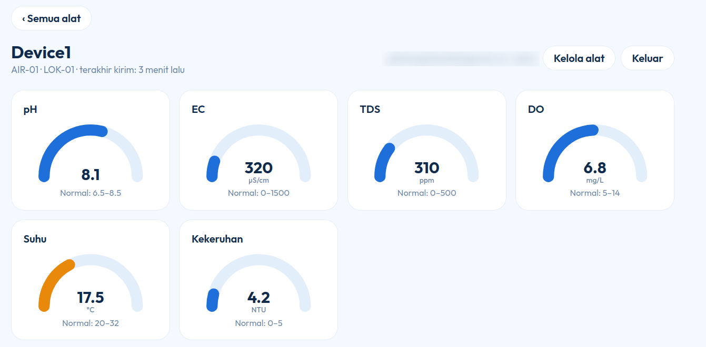
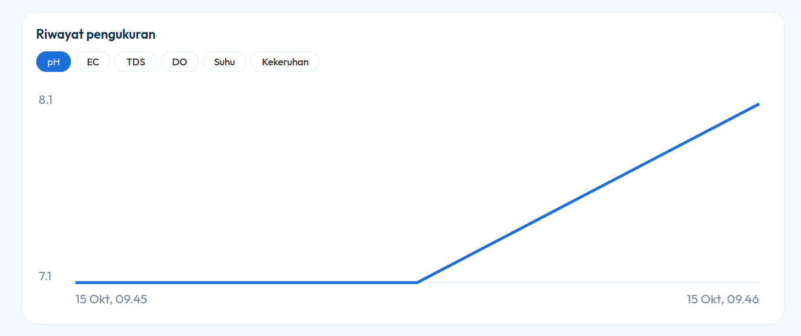
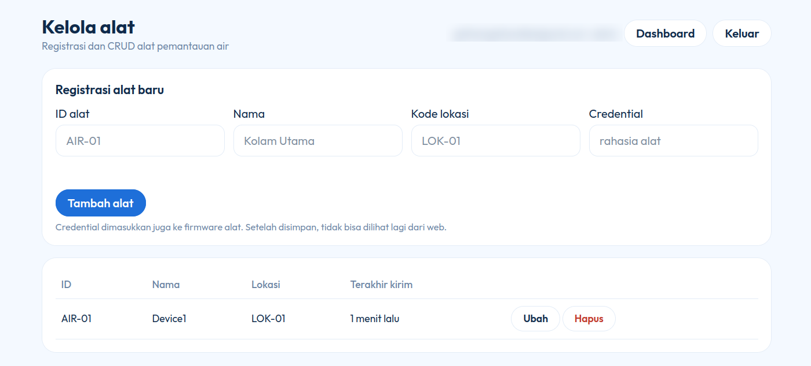

# AirTracking

Sistem pemantauan kualitas air berbasis IoT. Alat portable berbasis ESP32 mengukur **pH, EC, TDS, DO (oksigen terlarut), suhu, dan kekeruhan**, lalu mengirim datanya lewat MQTT atau HTTP ke server. Data disimpan di Supabase dan ditampilkan pada dashboard web bertema putih-biru.

Struktur proyek mengikuti pola [AgriFlow](https://github.com/gathanega/agriflow): `firmware/`, `server/`, `supabase/`, dan `web/`.

## Fitur

- Dashboard grafis: ringkasan alat, kartu per alat, gauge tiap parameter, dan grafik riwayat pengukuran.
- Login dengan dua peran: **User** (melihat data) dan **Admin** (melihat data dan mengelola alat).
- Registrasi alat (CRUD) oleh admin: ID alat, nama, kode lokasi, dan credential.
- Server memvalidasi ID alat dan credential sebelum menyimpan data.
- Data dikirim lewat **MQTT** (`airtracking/<ID_ALAT>/data`) atau **HTTP** (`POST /api/ingest`).
- Penanda **Perlu perhatian** bila ada parameter di luar rentang normal.
- Keamanan data memakai Row Level Security (RLS) Supabase. Credential alat tidak bisa dibaca dari web.

## Screenshot

| Dashboard | Detail alat |
|---|---|
|  |  |

| Grafik riwayat | Kelola alat (admin) |
|---|---|
|  |  |

## Arsitektur

```
ESP32 (sensor node + controller)
        |  MQTT: airtracking/<ID_ALAT>/data   atau   HTTP POST /api/ingest
        v
Server FastAPI  --(validasi ID alat + credential)-->  Supabase (PostgreSQL + Auth)
                                                              ^
                                    Dashboard web (login Supabase, baca data)
```

## Struktur folder

```
firmware/    (rencana) firmware ESP32 sensor node dan controller
server/      FastAPI: terima data (MQTT/HTTP), validasi, simpan ke Supabase
supabase/    schema.sql: tabel, trigger, dan kebijakan RLS
web/         dashboard.html + config.js
docs/        screenshot
```

## Format data JSON

```json
{
  "ts": "2026-10-15T08:30:00Z",
  "loc": "LOK-01",
  "id": "AIR-01",
  "key": "credential-alat",
  "ph": 7.1,
  "ec": 420,
  "tds": 210,
  "do": 6.8,
  "temp": 27.5,
  "turb": 3.2
}
```

| Field | Keterangan |
|---|---|
| `ts` | Timestamp dari RTC alat (opsional; bila kosong, memakai waktu server) |
| `loc` | Kode lokasi |
| `id` | ID alat (harus sudah diregistrasi) |
| `key` | Credential alat |
| `ph`, `ec`, `tds`, `do`, `temp`, `turb` | Nilai sensor: pH, EC (µS/cm), TDS (ppm), DO (mg/L), suhu (°C), kekeruhan (NTU) |

## Hardware (rencana)

Alat portable dengan dua ESP32 DevKit 38-pin (controller dan sensor node). Mode IoT hanya aktif saat data akan dikirim ke server.

| Bagian | Komponen |
|---|---|
| Sensor | pH analog (probe BNC), TDS/EC DFRobot, kekeruhan DFRobot, DS18B20, DO fluoresensi SN-3002-LDO |
| ADC dan konverter | ADS1115 (16-bit), MAX485 (RS485 ke TTL) |
| Controller | Modul microSD, RTC DS3231, LCD 16x2 I2C, push button (ukur, kirim, prediksi), saklar mode konfigurasi |
| Daya | Li-ion 18650, TP4056, buck 3.3 V, LDO rendah noise, boost, proteksi (fuse, MOSFET) |

Daftar lengkap ada di berkas komponen proyek.

## Instalasi

### Kebutuhan

- Ubuntu (lokal atau VPS), Python 3.10 atau lebih baru
- Akun [Supabase](https://supabase.com) (paket gratis cukup)
- (Opsional) broker MQTT, misalnya Mosquitto

### 1. Supabase

1. Buat project baru di Supabase.
2. Buka **SQL Editor**, tempel isi [`supabase/schema.sql`](supabase/schema.sql), lalu **Run**.
3. Buka **Authentication > Users > Add user**, buat akun (centang *Auto Confirm User*).
4. Jadikan akun itu admin lewat SQL Editor (ganti emailnya):

   ```sql
   insert into profiles (id, role)
   select id, 'admin' from auth.users where email = 'email_anda@contoh.com'
   on conflict (id) do update set role = 'admin';
   ```

5. Buka **Project Settings > API Keys**, lalu catat:

   | Kunci | Dipakai di |
   |---|---|
   | Project URL | `server/config.yaml` dan `web/config.js` |
   | Secret key (`service_role`) | `server/config.yaml` saja |
   | Publishable key (`anon`) | `web/config.js` |

### 2. Server

```bash
git clone https://github.com/gathanega/airtracking.git
cd airtracking/server

python3 -m venv venv
. venv/bin/activate
pip install -r requirements.txt

cp config.example.yaml config.yaml
nano config.yaml        # isi url dan service_key (hapus blok mqtt bila belum dipakai)

uvicorn app:app --host 0.0.0.0 --port 8000
```

Cek: `curl http://localhost:8000/api/health` harus membalas `{"ok":true}`.

### 3. MQTT (opsional)

```bash
sudo apt install -y mosquitto mosquitto-clients
sudo systemctl enable --now mosquitto
```

Untuk uji coba di jaringan lokal, buat `/etc/mosquitto/conf.d/air.conf`:

```
listener 1883
allow_anonymous true
```

Lalu `sudo systemctl restart mosquitto`. Opsi `allow_anonymous true` hanya untuk uji coba lokal. Untuk penggunaan nyata, aktifkan username dan password.

### 4. Dashboard

Isi `web/config.js`:

```js
window.AIR_CONFIG = {
  SUPABASE_URL: "https://PROJECT_REF.supabase.co",
  SUPABASE_ANON: "PUBLISHABLE_ATAU_ANON_KEY"
};
```

Jalankan (pilih port yang kosong, misalnya 8090):

```bash
cd web
python3 -m http.server 8090
```

Buka `http://localhost:8090/dashboard.html`, lalu login.

### 5. Registrasi alat dan tes kirim data

1. Login sebagai admin, buka **Kelola alat**, dan daftarkan alat (ID, nama, kode lokasi, credential).
2. Kirim data contoh lewat HTTP:

   ```bash
   curl -X POST http://localhost:8000/api/ingest -H "Content-Type: application/json" \
     -d '{"id":"AIR-01","key":"credential-alat","loc":"LOK-01","ph":7.1,"ec":420,"tds":210,"do":6.8,"temp":27.5,"turb":3.2}'
   ```

   Atau lewat MQTT:

   ```bash
   mosquitto_pub -h localhost -t airtracking/AIR-01/data \
     -m '{"id":"AIR-01","key":"credential-alat","loc":"LOK-01","ph":7.2,"ec":430,"tds":215,"do":6.9,"temp":27.8,"turb":3.0}'
   ```

3. Kartu alat di dashboard terisi dalam sekitar 5 detik. Grafik riwayat muncul setelah ada minimal 2 data.

### Produksi (VPS)

Jalankan server sebagai service systemd memakai [`server/airtracking.service`](server/airtracking.service):

```bash
sudo cp server/airtracking.service /etc/systemd/system/
sudo systemctl daemon-reload
sudo systemctl enable --now airtracking
```

Sesuaikan `WorkingDirectory` dan `ExecStart` dengan lokasi proyek. Bila alat mengirim data lewat internet, pasang HTTPS (misalnya nginx dengan Let's Encrypt).

## Menghentikan server

- Server uvicorn dan dashboard (`http.server`) dihentikan dengan **Ctrl+C** di terminal masing-masing.
- Bila prosesnya macet atau port masih terpakai (`Address already in use`):

  ```bash
  sudo ss -ltnp | grep -E ":(8000|8090)"     # cari PID
  sudo kill -9 PID
  ```

- Bila dijalankan sebagai service systemd: `sudo systemctl stop airtracking`.

## Pemecahan masalah

| Gejala | Penyebab umum |
|---|---|
| `Address already in use` | Port dipakai program lain. Hentikan prosesnya atau pakai port lain (`--port 8001`). |
| `401` saat kirim data | ID alat atau credential tidak cocok dengan yang diregistrasi. |
| Tombol **Kelola alat** tidak muncul | Akun belum admin. Jalankan query admin lalu login ulang. |
| Login gagal | `web/config.js` salah, atau user belum dibuat dengan *Auto Confirm*. |
| Server error saat start | Periksa `url` dan `service_key` di `config.yaml`. Coba `pip install -U supabase`. |
| ESP32 tidak bisa terhubung | Pakai IP laptop/server (bukan `localhost`) dan buka port 8000 atau 1883 di firewall. |

## Keamanan

- **Jangan** commit `server/config.yaml` (sudah ada di `.gitignore`). Berkas itu berisi Secret key.
- Secret key hanya untuk server. Dashboard memakai Publishable (`anon`) key.
- Bila Secret key pernah terunggah ke repositori publik, buat key baru di Supabase dan hapus yang lama.
- Ganti `allow_anonymous true` pada Mosquitto dengan autentikasi sebelum dipakai di luar jaringan lokal.

## Rencana pengembangan

- [ ] Firmware ESP32: baca sensor, mode AP untuk konfigurasi WiFi, mode internet, kirim via MQTT
- [ ] Penyimpanan cadangan di microSD saat tidak ada koneksi
- [ ] Prediksi kualitas air dengan machine learning
- [ ] Sesuaikan rentang normal dengan baku mutu yang dipakai (objek `P` di `web/dashboard.html`)
- [ ] Samakan antarmuka sensor DO (dokumen rancangan menyebut RS232, daftar komponen RS485)

## Kredit

Struktur proyek terinspirasi dari AgriFlow/GreenFlow.
