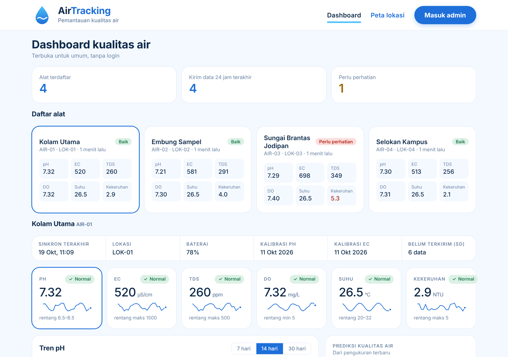
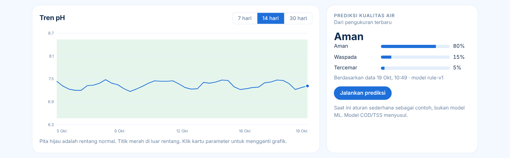
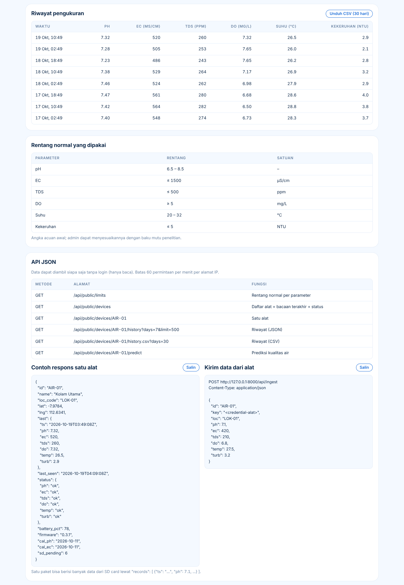
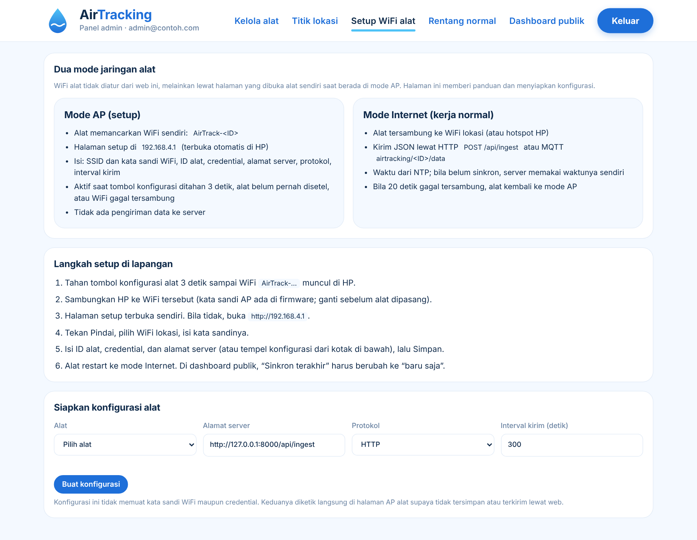
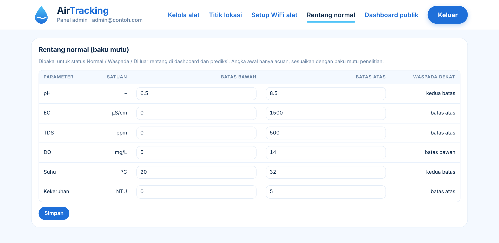
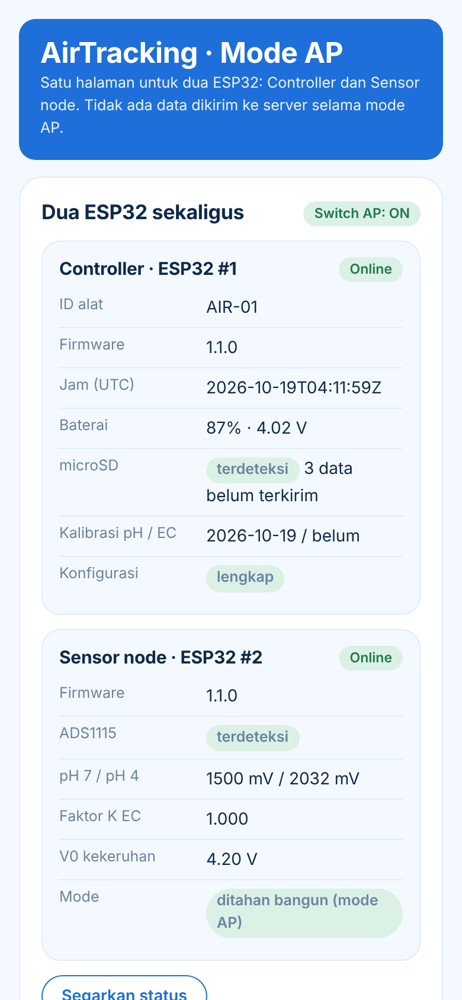
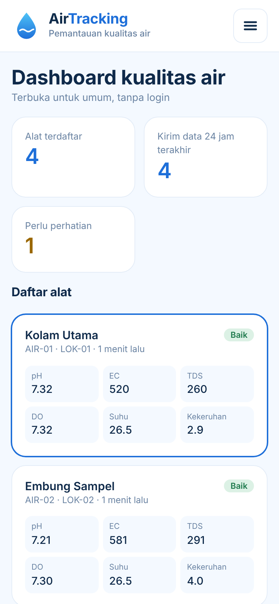

# 💧 AirTracking

Sistem pemantauan kualitas air berbasis IoT. Alat portable berbasis **ESP32** mengukur **pH, EC, TDS, DO (oksigen terlarut), suhu, dan kekeruhan**, lalu mengirim datanya lewat HTTP ke server. Backend dan dashboard dibuat dalam satu proyek **Laravel**: **web publik** (tanpa login), **panel admin** (login), **API JSON**, dan penerima data dari alat.




## Daftar isi

- [Fitur](#fitur)
- [Tampilan](#tampilan)
- [Arsitektur](#arsitektur)
- [Struktur folder](#struktur-folder)
- [Instalasi server (web)](#instalasi-server-web)
- [Instalasi firmware (alat)](#instalasi-firmware-alat)
- [Format data dan API](#format-data-dan-api)
- [Hardware](#hardware)
- [Pemecahan masalah](#pemecahan-masalah)
- [Keamanan](#keamanan)
- [Status dan rencana pengembangan](#status-dan-rencana-pengembangan)

## Fitur

- **Dashboard grafis**: ringkasan alat, kartu parameter + sparkline, grafik tren 7/14/30 hari, dan riwayat pengukuran. Diperbarui otomatis tiap 15 detik.
- **Peta lokasi alat** (Leaflet + OpenStreetMap) dengan titik berwarna sesuai status.
- **Panel admin** untuk registrasi alat (CRUD): ID alat, nama, kode lokasi, credential, dan koordinat.
- **Validasi di server**: ID alat dan credential diperiksa sebelum data disimpan.
- **Status otomatis** per parameter (Normal / Waspada / Di luar rentang); rentang normal bisa diubah admin.
- **Prediksi kualitas air** (`aman` / `waspada` / `tercemar`), saat ini berbasis aturan sederhana.
- **Cadangan microSD** di alat: data tetap tersimpan saat WiFi/server putus dan dikirim pada siklus berikutnya.
- **Mode AP** di alat: setup WiFi, identitas, dan kalibrasi lewat satu halaman web dari HP.
- Credential alat disimpan sebagai hash dan tidak pernah ditampilkan oleh API publik.

## Tampilan

Semua halaman bertema **putih-biru**, berbahasa Indonesia, dan responsif (HP sampai desktop). Panduan lengkapnya ada di [`docs/TAMPILAN.md`](docs/TAMPILAN.md).

| Halaman | Alamat | Akses | Isi |
|---|---|---|---|
| Dashboard | `/` | Publik | Ringkasan, daftar alat, kartu parameter + sparkline, grafik tren, prediksi, riwayat, daftar API |
| Peta lokasi | `/lokasi` | Publik | Peta alat dengan titik berwarna sesuai status |
| Login admin | `/admin/login` | Publik (form) | Masuk admin, dibatasi 5 percobaan gagal per 5 menit |
| Kelola alat | `/admin/devices` | Admin | Registrasi, ubah, nonaktifkan, ganti credential, hapus alat |
| Titik lokasi | `/admin/lokasi` | Admin | Tandai titik alat di peta (klik, geser, atau ketik koordinat) |
| Setup WiFi alat | `/admin/wifi` | Admin | Panduan mode AP/Internet dan pembuat konfigurasi JSON |
| Setup di alat (Mode AP) | `192.168.4.1` | Lewat WiFi alat | Status, pembacaan langsung, WiFi/server, dan kalibrasi ([lihat tampilan](#halaman-setup-alat-mode-ap)) |
| Rentang normal | `/admin/limits` | Admin | Ubah baku mutu tiap parameter |

### Dashboard publik

Satu kartu per alat (nama, ID, kode lokasi, waktu kirim terakhir, dan enam nilai terbaru), lalu detail alat terpilih: strip status (sinkron, baterai, kalibrasi, antrean SD), enam kartu parameter dengan sparkline, grafik tren dengan pita rentang normal, dan panel prediksi.






### Arti warna status

Status selalu disertai simbol dan teks, bukan warna saja.

| Status | Label | Warna | Kapan |
|---|---|---|---|
| Normal | ✓ Normal | Hijau | Nilai di dalam rentang normal |
| Waspada | ! Waspada | Kuning | Di dalam rentang, tetapi kurang dari 10% lebar rentang dari batas |
| Di luar rentang | ▲ Di luar rentang | Merah | Nilai melewati batas bawah atau atas |
| Belum ada data | Belum ada data | Abu-abu | Alat belum pernah mengirim data |

### Panel admin

| Kelola alat | Setup WiFi alat | Rentang normal |
|---|---|---|
|  |  |  |

### Halaman setup alat (Mode AP)

Selain web server, alat sendiri punya halaman web saat **switch AP ON**. HP tersambung ke WiFi `AirTrack-<ID>`, lalu halaman terbuka otomatis di `http://192.168.4.1`. Satu halaman ini mengatur **dua ESP32 sekaligus** (controller dan sensor node):

- status kedua ESP32 (ID alat, firmware, jam, baterai, microSD, ADS1115, nilai kalibrasi),
- **pembacaan langsung** sensor yang diperbarui tiap 3 detik,
- pengaturan WiFi lokasi, identitas alat, credential, alamat server, protokol, dan interval kirim,
- ukur penuh dan kalibrasi pH, EC, dan kekeruhan.

| Layar pertama | Seluruh halaman |
|---|---|
|  |  |

> Halaman ini dapat dilihat tanpa alat: buka `firmware/ap_page.html` di browser dengan tambahan `?demo` pada alamatnya.

### Tampilan di HP

Menu berubah menjadi tombol burger (☰) di layar 1000 px ke bawah; grafik dan peta menjadi satu kolom di 860 px ke bawah.

| Menu di HP | Dashboard di HP |
|---|---|
|  |  |

Bila server tidak terjangkau, dashboard memakai data contoh dan menampilkan penanda **"Data contoh, server belum terhubung"**.

## Arsitektur

```
ESP32 sensor node ──UART──► ESP32 controller (RTC, microSD, LCD, WiFi)
                                   │  HTTP POST /api/ingest  (ID alat + credential)
                                   ▼
        Laravel (web publik, panel admin, API JSON)  ──►  Database
                                   ▲
                                   │  baca data (API publik, tanpa login)
                          Dashboard web (halaman publik)
```

## Struktur folder

```
app/         controller, model, middleware, service (MeasurementIngestor, Quality)
database/    migrasi dan seeder (rentang normal awal, data demo)
docs/        skema database, panduan tampilan, screenshots
public/      aset CSS dan JS dashboard
resources/   tampilan (Blade), CSS, JS
routes/      web.php, api.php
tests/       tes otomatis
firmware/    firmware ESP32: controller/ dan sensor_node/ (lihat firmware/README.md)
```

## Instalasi server (web)

### Kebutuhan

- PHP **8.4.1 atau lebih baru** (sesuai `composer.lock`, yang memakai Symfony 8) (ekstensi umum Laravel: `mbstring`, `xml`, `curl`, `zip`, dan driver database yang dipakai)
- [Composer](https://getcomposer.org/)
- Database: SQLite (paling mudah untuk mencoba), MySQL/MariaDB, atau PostgreSQL
- Node.js + npm hanya bila ingin membangun ulang aset lewat Vite (opsional)

### Langkah cepat (lokal)

```bash
git clone https://github.com/<username>/airtracking.git
cd airtracking

composer install
cp .env.example .env
php artisan key:generate
```

Atur database di `.env`. Pilih salah satu:

```env
# Opsi A: SQLite (tanpa server database)
DB_CONNECTION=sqlite
# lalu buat berkasnya:  touch database/database.sqlite

# Opsi B: MySQL / MariaDB
DB_CONNECTION=mysql
DB_HOST=127.0.0.1
DB_PORT=3306
DB_DATABASE=airtracking
DB_USERNAME=...
DB_PASSWORD=...
# PostgreSQL: DB_CONNECTION=pgsql dan DB_PORT=5432

APP_TIMEZONE=UTC      # biarkan UTC; waktu ditampilkan sesuai zona browser
```

Lanjutkan:

```bash
php artisan migrate --seed                                            # tabel + rentang normal awal
php artisan airtracking:make-admin admin@contoh.com --name="Admin"    # akan meminta kata sandi
php artisan db:seed --class=DemoSeeder                                # opsional: 4 alat + data contoh (Kota Malang)
php artisan serve                                                     # http://127.0.0.1:8000
```

Buka `http://127.0.0.1:8000` untuk dashboard dan `http://127.0.0.1:8000/admin/login` untuk panel admin.

Jalankan tes otomatis:

```bash
php artisan test
```

### Mengirim data percobaan

Setelah alat didaftarkan di `/admin/devices` (atau memakai data demo), kirim data dengan `curl`:

```bash
curl -X POST http://127.0.0.1:8000/api/ingest -H "Content-Type: application/json" \
  -d '{"id":"AIR-01","key":"demo-credential-01","loc":"LOK-01","ph":7.1,"ec":420,"tds":210,"do":6.8,"temp":27.5,"turb":3.2}'
```

Kartu alat di dashboard terisi setelah data masuk. Grafik riwayat muncul setelah ada minimal 2 data.

### Produksi (VPS Ubuntu)

1. Pasang PHP 8.4, Composer, nginx (atau Apache), dan database.
2. Arahkan root web server ke folder `public/`.
3. **Pasang HTTPS** (alat mengirim credential lewat jaringan).
4. Atur `.env` produksi (`APP_ENV=production`, `APP_DEBUG=false`, kredensial database), lalu:

```bash
composer install --no-dev --optimize-autoloader
php artisan migrate --force
php artisan config:cache && php artisan route:cache
```

Jalankan lewat PHP-FPM + nginx, dan pantau dengan systemd bila memakai worker antrean.

## Instalasi firmware (alat)

Firmware Arduino untuk **dua ESP32 DevKit 38-pin**: `controller` (jadwal, daya, microSD, RTC, LCD, WiFi, kirim ke server, mode AP) dan `sensor_node` (ADS1115, DS18B20, kalibrasi). Rincian lengkap ada di [`firmware/README.md`](firmware/README.md).

### 1. Siapkan Arduino IDE

- Pasang board **esp32 by Espressif** (core 2.0.x atau 3.x), pilih board **ESP32 Dev Module**.
- Pasang library lewat Library Manager:

| Sketch | Library |
|---|---|
| `controller` | `RTClib` (Adafruit), `LiquidCrystal_I2C` (Frank de Brabander), `PubSubClient` (hanya bila `USE_MQTT 1`) |
| `sensor_node` | `Adafruit ADS1X15`, `OneWire`, `DallasTemperature` |

WiFi, WebServer, DNSServer, HTTPClient, SD, dan Preferences sudah bawaan core ESP32.

### 2. Atur `config.h`

- Di `controller/config.h`: **ganti `AP_PASSWORD`** (bawaan `airtrack123`). Untuk HTTPS produksi, isi `ROOT_CA` dengan PEM root CA server (bila kosong, sertifikat tidak diverifikasi).
- `protocol.h` harus sama di kedua folder sketch.
- Sensor DO (fase 2): set `USE_DO 1` di **kedua** `config.h` setelah memeriksa parameter Modbus di datasheet.

### 3. Unggah

Buka `controller/controller.ino` dan `sensor_node/sensor_node.ino` sebagai dua sketch terpisah, lalu unggah masing-masing ke ESP32-nya. Saat flashing lewat USB, **lepas catu eksternal ke pin 3V3**.

### 4. Setup alat di lapangan (mode AP)

1. **Daftarkan alat di web**: `/admin/devices` → isi ID alat, nama, kode lokasi → catat **credential** (hanya tampil sekali).
2. Geser **switch AP ke ON**, lalu sambungkan HP ke WiFi **`AirTrack-<ID>`**.
3. Halaman setup ([tampilannya](#halaman-setup-alat-mode-ap)) terbuka otomatis; bila tidak, buka `http://192.168.4.1`. Kartu Controller dan Sensor node harus **Online**.
4. **Pindai WiFi**, pilih WiFi lokasi, lalu isi ID alat, kode lokasi, credential, alamat server (mis. `https://domain-anda/api/ingest`), dan interval. Atau tempel JSON dari `/admin/wifi`. Tekan **Simpan pengaturan**.
5. Kalibrasi pH (2 titik: buffer 7.00 dan 4.00), EC (larutan 1413 µS/cm), dan kekeruhan (aquades) sambil memantau **Pembacaan langsung**.
6. Geser **switch AP ke OFF**. Alat langsung mengukur dan mengirim, lalu tidur sesuai interval (bawaan 15 menit, minimum 60 detik).

> **Status firmware:** kode sudah ditulis dan dicek sintaksnya, tetapi **belum diuji di hardware** dengan toolchain ESP32 asli. Siapkan waktu uji bench pertama (panduan ada di `firmware/README.md`).

## Format data dan API

Data dari alat (`POST /api/ingest`, 120 permintaan per menit per IP):

```json
{
  "ts": "2026-10-17T08:30:00Z",
  "loc": "LOK-01",
  "id": "AIR-01",
  "key": "credential-alat",
  "ph": 7.1,
  "ec": 420,
  "tds": 210,
  "do": 6.8,
  "temp": 27.5,
  "turb": 3.2
}
```

| Field | Keterangan |
|---|---|
| `ts` | Timestamp UTC dari RTC alat (opsional; bila kosong memakai waktu server) |
| `loc` | Kode lokasi |
| `id` | ID alat (harus sudah diregistrasi) |
| `key` | Credential alat |
| `ph`, `ec`, `tds`, `do`, `temp`, `turb` | pH, EC (µS/cm), TDS (ppm), DO (mg/L), suhu (°C), kekeruhan (NTU) |

Banyak data sekaligus (antrean SD): ganti nilai sensor dengan `"records":[{"ts":"...","ph":7.1,...}]` (maks 500). Field status opsional: `fw`, `bat` (0–100), `cal_ph`, `cal_ec`, `sd_pending`. Balasan `{"ok":true,"saved":N}`; `401` bila ID atau credential salah; `422` bila nilai di luar batas fisik.

API publik (hanya baca, 60 permintaan per menit per IP):

| Metode | Alamat | Fungsi |
|---|---|---|
| GET | `/api/public/limits` | Rentang normal |
| GET | `/api/public/devices` | Semua alat aktif + bacaan terakhir + status per parameter |
| GET | `/api/public/devices/{id}` | Satu alat |
| GET | `/api/public/devices/{id}/history?days=7&limit=500` | Riwayat (`days` 1–365, `limit` ≤ 1000) |
| GET | `/api/public/devices/{id}/history.csv?days=30` | Riwayat CSV |
| GET | `/api/public/devices/{id}/predict` | Prediksi terbaru |

Skema database: [`docs/skema-database.md`](docs/skema-database.md).

## Hardware

Alat portable dengan dua ESP32 DevKit 38-pin (controller dan sensor node). Mode IoT hanya aktif saat data akan dikirim.

| Bagian | Komponen |
|---|---|
| Sensor | pH analog (probe BNC), TDS/EC DFRobot, kekeruhan DFRobot, DS18B20, DO fluoresensi SN-3002-LDO (fase 2) |
| ADC dan konverter | ADS1115 (16-bit), MAX485 / SP3485 (RS485 ke TTL) |
| Controller | Modul microSD, RTC DS3231, LCD 16x2 I2C, tombol UKUR dan LCD, switch mode AP |
| Daya | Li-ion 18650, TP4056, buck 3.3 V, LDO rendah noise, boost, proteksi (fuse, MOSFET) |

Pinout lengkap dan cara kerja siklus ukur ada di [`firmware/README.md`](firmware/README.md).

## Pemecahan masalah

| Gejala | Penyebab umum |
|---|---|
| `Address already in use` | Port 8000 dipakai program lain. Pakai `php artisan serve --port=8001`. |
| Error koneksi database | Periksa `DB_*` di `.env`, lalu `php artisan config:clear`. |
| Menu admin ditolak | Akun belum admin. Buat dengan `php artisan airtracking:make-admin`. |
| Login gagal terus | Dibatasi 5 percobaan per 5 menit per email dan IP. Tunggu lalu coba lagi. |
| `401` saat kirim data | ID alat atau credential tidak cocok. Ganti credential di `/admin/devices`, isi ulang lewat mode AP. |
| `422` saat kirim data | Nilai sensor di luar batas fisik (mis. pH > 14). Di alat, data dipindah ke `/rejected.ndjson`. |
| ESP32 tidak bisa terhubung ke server lokal | Pakai IP laptop (bukan `localhost`), jalankan `php artisan serve --host=0.0.0.0`, dan buka port 8000 di firewall. |
| `Sensor node tidak merespons` | Kabel UART harus silang (TX↔RX), GND bersama, jalur WAKE GPIO25→GPIO33, catu 3V3 node hidup. |
| `ADS1115 tidak terdeteksi` | Rail 5V/LDO analog belum menyala, alamat I2C bukan 0x48, SDA/SCL tertukar. |
| Jam alat tidak benar | Baterai CR2032 DS3231 habis; alat otomatis sinkron NTP bila ada WiFi. |
| LCD kosong | Rail 5V mati, level shifter belum terpasang, atau alamat bukan 0x27/0x3F. |

## Keamanan

- Credential alat disimpan sebagai hash SHA-256 dan hanya tampil sekali (saat dibuat atau diganti). Bila kolom dikosongkan, credential acak 24 karakter dibuat otomatis.
- API publik tidak pernah mengembalikan credential. Semua halaman admin dilindungi `EnsureAdmin` di sisi server.
- Form admin memakai CSRF Laravel; API `/api/*` tanpa sesi.
- **Jangan commit `.env`** (berisi kredensial database dan `APP_KEY`).
- Pasang **HTTPS** di produksi dan isi `ROOT_CA` di firmware.
- Credential dan sandi WiFi tersimpan polos di NVS alat; aktifkan flash encryption bila alat bisa jatuh ke tangan lain.
- Ganti `AP_PASSWORD` bawaan firmware sebelum alat dipasang.

## Status dan rencana pengembangan

- [x] Web publik, panel admin, API JSON, dan penerima data HTTP
- [x] Firmware ESP32: baca sensor, mode AP, kalibrasi, kirim via HTTP, cadangan microSD (v1.1, belum diuji di hardware)
- [ ] Uji bench firmware di hardware asli
- [ ] Penerima MQTT di server (firmware sudah mendukung; `MeasurementIngestor` siap dipakai)
- [ ] Prediksi kualitas air dengan machine learning (saat ini aturan sederhana; kolom `cod_mg_l` dan `tss_mg_l` sudah disiapkan)
- [ ] Perintah dari server ke alat (konfigurasi jarak jauh)
- [ ] Verifikasi antarmuka sensor DO (dokumen rancangan menyebut RS232, daftar komponen RS485; firmware memakai RS485)

> Rentang normal awal hanyalah acuan; sesuaikan di `/admin/limits` dengan baku mutu yang dipakai.

## Kredit

Struktur proyek terinspirasi dari AgriFlow/GreenFlow.
