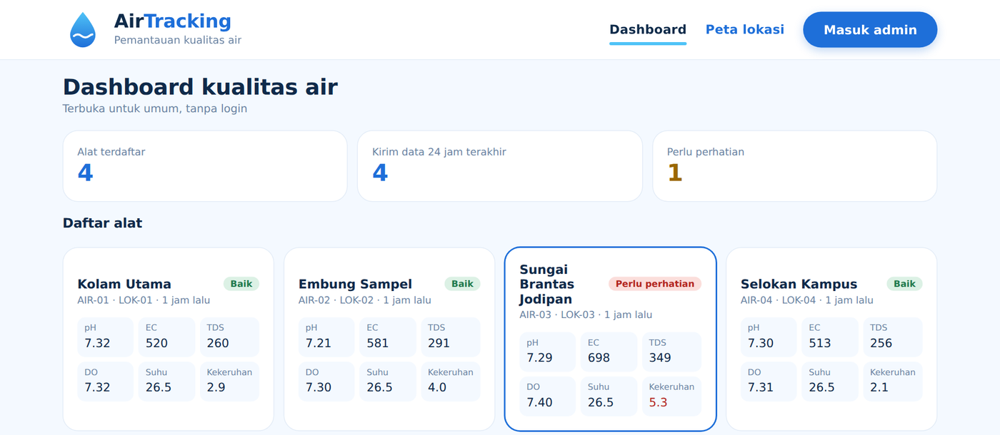
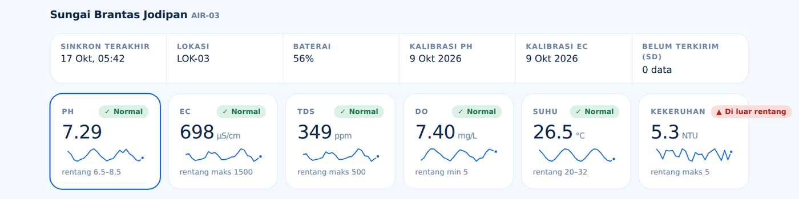
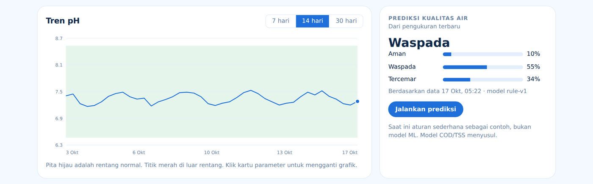
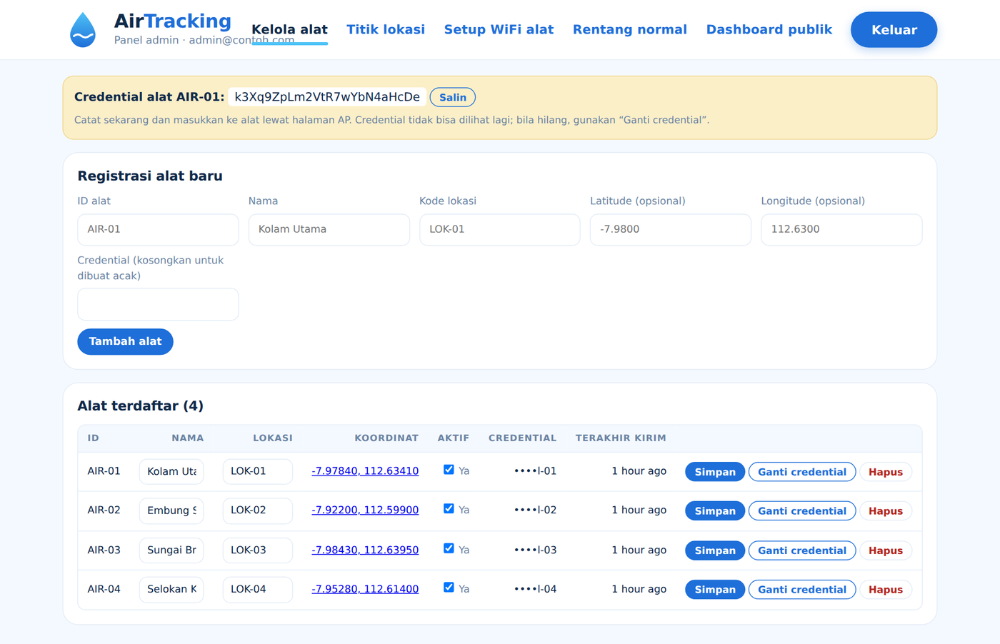
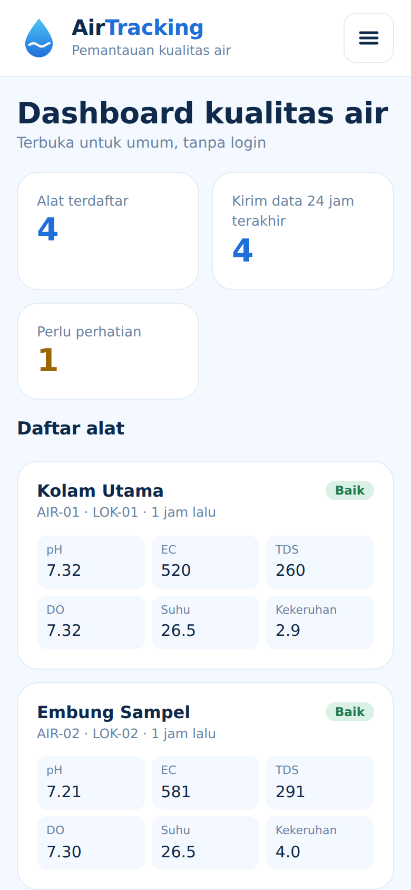

# AirTracking

Sistem pemantauan kualitas air berbasis IoT. Alat portable berbasis ESP32 mengukur **pH, EC, TDS, DO (oksigen terlarut), suhu, dan kekeruhan**, lalu mengirim datanya lewat HTTP ke server. Backend dan dashboard dibuat dalam satu proyek **Laravel**: web publik (tanpa login), panel admin (login), API JSON, dan penerima data dari alat.




## Daftar isi

- [Fitur](#fitur)
- [Tampilan](#tampilan)
- [Arsitektur](#arsitektur)
- [Instalasi](#instalasi)
  - [Persyaratan](#persyaratan)
  - [Instalasi lokal (SQLite, paling cepat)](#instalasi-lokal-sqlite-paling-cepat)
  - [Memakai MySQL / MariaDB / PostgreSQL](#memakai-mysql--mariadb--postgresql)
  - [Pasang di server (VPS Ubuntu + Nginx)](#pasang-di-server-vps-ubuntu--nginx)
  - [Pasang di hosting cPanel](#pasang-di-hosting-cpanel)
- [Menyambungkan alat ESP32](#menyambungkan-alat-esp32)
- [Halaman](#halaman)
- [API](#api)
- [Pemecahan masalah](#pemecahan-masalah)
- [Keamanan](#keamanan)
- [Struktur folder](#struktur-folder)
- [Belum ada dan rencana](#belum-ada-dan-rencana)

## Fitur

- Dashboard grafis: ringkasan alat, kartu parameter dengan sparkline, gauge, grafik tren 7/14/30 hari, dan riwayat pengukuran.
- Peta lokasi alat (Leaflet + OpenStreetMap) dengan titik berwarna sesuai status.
- Panel admin untuk registrasi alat: ID alat, nama, kode lokasi, credential, dan koordinat.
- Server memvalidasi ID alat dan credential sebelum menyimpan data.
- Data dikirim lewat **HTTP** (`POST /api/ingest`), termasuk kiriman banyak data sekaligus dari antrean microSD.
- Penanda **Perlu perhatian** bila ada parameter di luar rentang normal. Rentang normal bisa diubah admin.
- Prediksi kualitas air (`aman` / `waspada` / `tercemar`), saat ini berbasis aturan sederhana.
- Credential alat disimpan sebagai hash dan tidak pernah ditampilkan oleh API publik.

## Tampilan

| Detail alat | Grafik dan prediksi |
|---|---|
|  |  |

| Kelola alat (admin) | Tampilan HP |
|---|---|
|  |  |

Penjelasan semua halaman, arti warna status, dan perilaku di layar kecil ada di [`docs/TAMPILAN.md`](docs/TAMPILAN.md). Skema database ada di [`docs/skema-database.md`](docs/skema-database.md).

## Arsitektur

```
ESP32 (sensor node + controller)
        |  HTTP POST /api/ingest   (validasi ID alat + credential)
        v
Laravel (web publik, panel admin, API JSON)  -->  Database (SQLite / MySQL / MariaDB / PostgreSQL)
        ^
        |  baca data (API publik, tanpa login)
Dashboard web (halaman publik)
```

## Instalasi

### Persyaratan

| Kebutuhan | Keterangan |
|---|---|
| PHP **8.3 atau lebih baru** | Ekstensi: `ctype`, `curl`, `dom`, `fileinfo`, `mbstring`, `openssl`, `pdo`, `tokenizer`, `xml`, dan driver database (`pdo_sqlite`, `pdo_mysql`, atau `pdo_pgsql`) |
| [Composer](https://getcomposer.org) 2 | Untuk memasang dependensi PHP |
| Git | Untuk mengambil kode |
| Browser dengan internet | Peta memakai Leaflet dari `unpkg.com` dan font dari Google Fonts |

Node.js **tidak diperlukan**. Halaman memakai CSS dan JS statis di `public/`.

Cek versi PHP dan Composer:

```bash
php -v
composer -V
```

### Instalasi lokal (SQLite, paling cepat)

**1. Ambil kode dan pasang dependensi**

```bash
git clone https://github.com/USERNAME/airtracking.git
cd airtracking
composer install
```

Ganti `USERNAME/airtracking` dengan alamat repositori Anda.

**2. Siapkan folder yang dibutuhkan Laravel**

Git tidak menyimpan folder kosong, jadi buat dulu:

```bash
# Linux / macOS / Git Bash
mkdir -p storage/framework/cache/data storage/framework/sessions storage/framework/views storage/framework/testing storage/logs storage/app/public bootstrap/cache
```

```powershell
# Windows PowerShell
"storage/framework/cache/data","storage/framework/sessions","storage/framework/views","storage/framework/testing","storage/logs","storage/app/public","bootstrap/cache" | ForEach-Object { New-Item -ItemType Directory -Force $_ }
```

**3. Buat file `.env`**

Buat file bernama `.env` (diawali titik, tanpa nama di depannya) di folder utama proyek dengan isi berikut. File ini berisi pengaturan lokal dan **jangan di-commit**.

```env
APP_NAME=AirTracking
APP_ENV=local
APP_KEY=
APP_DEBUG=true
APP_URL=http://127.0.0.1:8000

LOG_CHANNEL=stack
LOG_LEVEL=debug

DB_CONNECTION=sqlite

SESSION_DRIVER=database
CACHE_STORE=database
QUEUE_CONNECTION=database
```

Waktu disimpan dalam UTC dan ditampilkan sesuai zona waktu browser, jadi tidak perlu mengatur zona waktu.

**4. Buat database SQLite dan kunci aplikasi**

```bash
# Linux / macOS / Git Bash
touch database/database.sqlite
```

```powershell
# Windows PowerShell
New-Item -ItemType File database/database.sqlite
```

```bash
php artisan key:generate
```

**5. Buat tabel dan data awal**

```bash
php artisan migrate --seed
```

Perintah ini membuat semua tabel dan mengisi rentang normal awal (baku mutu parameter).

**6. Buat akun admin**

```bash
php artisan airtracking:make-admin admin@contoh.com --name="Admin"
```

Anda akan diminta mengisi kata sandi (minimal 8 karakter).

**7. (Opsional) Isi data contoh**

```bash
php artisan db:seed --class=DemoSeeder
```

Ini membuat 4 alat contoh (`AIR-01` sampai `AIR-04`, titik di sekitar Kota Malang) dengan 90 data pengukuran. Credential alat contoh: `demo-credential-01` sampai `demo-credential-04`. **Jangan dipakai di server produksi.**

**8. Jalankan**

```bash
php artisan serve
```

Buka <http://127.0.0.1:8000> untuk dashboard publik, dan <http://127.0.0.1:8000/admin/login> untuk panel admin.

**9. Cek instalasi**

```bash
php artisan test
curl http://127.0.0.1:8000/api/health
```

Hasil `curl` yang benar: `{"ok":true}`.

### Memakai MySQL / MariaDB / PostgreSQL

Buat database kosong, misalnya untuk MySQL:

```sql
CREATE DATABASE airtracking CHARACTER SET utf8mb4 COLLATE utf8mb4_unicode_ci;
CREATE USER 'airtracking'@'localhost' IDENTIFIED BY 'ganti-kata-sandi';
GRANT ALL PRIVILEGES ON airtracking.* TO 'airtracking'@'localhost';
FLUSH PRIVILEGES;
```

Lalu ganti bagian database di `.env` (hapus baris `DB_CONNECTION=sqlite`):

```env
DB_CONNECTION=mysql        # atau pgsql
DB_HOST=127.0.0.1
DB_PORT=3306               # PostgreSQL: 5432
DB_DATABASE=airtracking
DB_USERNAME=airtracking
DB_PASSWORD=ganti-kata-sandi
```

Kemudian lanjutkan dari langkah `php artisan key:generate` di atas (tanpa langkah membuat file SQLite). Bila ada error koneksi, jalankan `php artisan config:clear`.

### Pasang di server (VPS Ubuntu + Nginx)

Contoh untuk Ubuntu 22.04/24.04. Sesuaikan domain dan versi PHP.

```bash
sudo apt update
sudo apt install -y nginx git unzip mysql-server \
  php8.3-fpm php8.3-cli php8.3-mysql php8.3-mbstring php8.3-xml php8.3-curl php8.3-zip
curl -sS https://getcomposer.org/installer | php && sudo mv composer.phar /usr/local/bin/composer
```

Ambil kode dan pasang dependensi produksi:

```bash
cd /var/www
sudo git clone https://github.com/USERNAME/airtracking.git
sudo chown -R $USER:www-data airtracking && cd airtracking
composer install --no-dev --optimize-autoloader
mkdir -p storage/framework/cache/data storage/framework/sessions storage/framework/views storage/logs storage/app/public bootstrap/cache
```

Buat `.env` produksi (database MySQL seperti di atas):

```env
APP_NAME=AirTracking
APP_ENV=production
APP_KEY=
APP_DEBUG=false
APP_URL=https://domain-anda.com

LOG_LEVEL=warning

DB_CONNECTION=mysql
DB_HOST=127.0.0.1
DB_PORT=3306
DB_DATABASE=airtracking
DB_USERNAME=airtracking
DB_PASSWORD=ganti-kata-sandi

SESSION_DRIVER=database
CACHE_STORE=database
QUEUE_CONNECTION=database
```

```bash
php artisan key:generate
php artisan migrate --seed --force
php artisan airtracking:make-admin admin@domain-anda.com --name="Admin"
sudo chgrp -R www-data storage bootstrap/cache
sudo chmod -R ug+rwx storage bootstrap/cache
php artisan config:cache && php artisan route:cache && php artisan view:cache
```

Konfigurasi Nginx (`/etc/nginx/sites-available/airtracking`):

```nginx
server {
    listen 80;
    server_name domain-anda.com;
    root /var/www/airtracking/public;
    index index.php;

    location / {
        try_files $uri $uri/ /index.php?$query_string;
    }

    location ~ \.php$ {
        include snippets/fastcgi-php.conf;
        fastcgi_pass unix:/run/php/php8.3-fpm.sock;
    }

    location ~ /\.(?!well-known).* {
        deny all;
    }
}
```

```bash
sudo ln -s /etc/nginx/sites-available/airtracking /etc/nginx/sites-enabled/
sudo nginx -t && sudo systemctl reload nginx
sudo apt install -y certbot python3-certbot-nginx && sudo certbot --nginx -d domain-anda.com
```

**Pasang HTTPS.** Alat mengirim credential lewat jaringan, jadi jangan memakai HTTP biasa di produksi.

Setiap kali kode diperbarui:

```bash
git pull
composer install --no-dev --optimize-autoloader
php artisan migrate --force
php artisan config:cache && php artisan route:cache && php artisan view:cache
```

### Pasang di hosting cPanel

1. Di komputer Anda, jalankan `composer install --no-dev --optimize-autoloader`, lalu unggah seluruh proyek **termasuk folder `vendor/`** (hosting biasa umumnya tidak punya Composer).
2. Buat database MySQL dan user lewat menu *MySQL Databases*, lalu isi `.env` seperti contoh produksi di atas.
3. Arahkan *document root* domain ke folder `public/`. Jika tidak bisa, letakkan isi proyek di luar `public_html`, lalu salin isi `public/` ke `public_html` dan ubah dua path di `public_html/index.php` agar menunjuk ke folder proyek.
4. Jalankan migrasi lewat Terminal cPanel (`php artisan migrate --seed --force`) atau SSH. Bila tidak ada akses terminal, impor tabel dari komputer lokal yang memakai database yang sama.
5. Pastikan `storage/` dan `bootstrap/cache/` bisa ditulis (izin 775).

## Menyambungkan alat ESP32

1. Login ke `/admin/devices`, lalu daftarkan alat: ID alat (mis. `AIR-01`), nama, kode lokasi. Catat **credential** yang muncul, karena hanya tampil sekali.
2. Di `/admin/wifi` ada panduan mode AP dan pembuat konfigurasi JSON untuk ditempel ke halaman setup alat.
3. Isi alamat server di alat, misalnya `https://domain-anda.com/api/ingest`. Saat uji lokal, pakai IP laptop (bukan `localhost`) dan jalankan `php artisan serve --host=0.0.0.0`, lalu buka port 8000 di firewall.
4. Setelah alat mengirim data, kartu alat di dashboard terisi. Grafik riwayat muncul setelah ada minimal 2 data.

Uji pengiriman tanpa alat (data contoh dari `DemoSeeder`):

```bash
curl -X POST http://127.0.0.1:8000/api/ingest -H "Content-Type: application/json" \
  -d '{"id":"AIR-01","key":"demo-credential-01","loc":"LOK-01","ph":7.1,"ec":420,"tds":210,"do":6.8,"temp":27.5,"turb":3.2}'
```

Balasan yang benar: `{"ok":true,"saved":1}`.

## Halaman

| Alamat | Akses | Isi |
|---|---|---|
| `/` | Publik | Ringkasan, daftar alat, kartu parameter + sparkline, grafik tren, prediksi, riwayat, daftar API |
| `/lokasi` | Publik | Peta lokasi alat, titik berwarna sesuai status |
| `/admin/login` | Publik (form) | Login admin, dibatasi 5 percobaan gagal per 5 menit per email dan IP |
| `/admin/devices` | Admin | Registrasi, ubah, nonaktifkan, ganti credential, hapus alat |
| `/admin/lokasi` | Admin | Tandai titik alat di peta (klik, geser, atau ketik koordinat) |
| `/admin/wifi` | Admin | Panduan mode AP dan mode Internet, pembuat konfigurasi JSON |
| `/admin/limits` | Admin | Ubah rentang normal (baku mutu) |

## API

### Alat ke server

`POST /api/ingest` (maks 120 permintaan per menit per IP):

```json
{
  "id": "AIR-01",
  "key": "credential-alat",
  "loc": "LOK-01",
  "ts": "2026-10-17T08:30:00Z",
  "ph": 7.1, "ec": 420, "tds": 210, "do": 6.8, "temp": 27.5, "turb": 3.2
}
```

| Field | Keterangan |
|---|---|
| `id` | ID alat (harus sudah diregistrasi) |
| `key` | Credential alat |
| `loc` | Kode lokasi |
| `ts` | Waktu dari RTC alat, UTC (opsional; bila kosong memakai waktu server) |
| `ph`, `ec`, `tds`, `do`, `temp`, `turb` | pH, EC (µS/cm), TDS (ppm), DO (mg/L), suhu (°C), kekeruhan (NTU) |
| `fw`, `bat`, `cal_ph`, `cal_ec`, `sd_pending` | Status alat, opsional |

Banyak data dari microSD dalam satu paket: ganti nilai sensor dengan `"records":[{"ts":"...","ph":7.1,...}]` (maksimal 500).

Balasan: `{"ok":true,"saved":N}`. `401` bila ID atau credential salah. `422` bila nilai di luar batas fisik (mis. pH > 14).

### Publik (hanya baca)

Maks 60 permintaan per menit per IP.

| Metode | Alamat | Fungsi |
|---|---|---|
| GET | `/api/health` | Cek server hidup |
| GET | `/api/public/limits` | Rentang normal |
| GET | `/api/public/devices` | Semua alat aktif + bacaan terakhir + status per parameter |
| GET | `/api/public/devices/{id}` | Satu alat |
| GET | `/api/public/devices/{id}/history?days=7&limit=500` | Riwayat, urut waktu naik (`days` 1–365, `limit` ≤ 1000) |
| GET | `/api/public/devices/{id}/history.csv?days=30` | Riwayat CSV |
| GET | `/api/public/devices/{id}/predict` | Prediksi terbaru (`aman` / `waspada` / `tercemar`) |

## Hardware

Alat portable dengan dua ESP32 DevKit 38-pin (controller dan sensor node). Mode IoT hanya aktif saat data dikirim ke server.

| Bagian | Komponen |
|---|---|
| Sensor | pH analog (probe BNC), EC/TDS DFRobot, kekeruhan DFRobot, DS18B20, DO fluoresensi SN-3002-LDO |
| ADC dan konverter | ADS1115 (16-bit), modul RS485 ke TTL |
| Controller | Modul microSD, RTC DS3231, LCD 16x2 I2C, tombol ukur dan LCD, switch mode AP |
| Daya | Li-ion 18650, TP4056, buck-boost 3.3 V, LDO analog, boost 5 V/12 V, proteksi (fuse, MOSFET) |

## Pemecahan masalah

| Gejala | Penyebab umum |
|---|---|
| `No application encryption key has been specified` | Belum menjalankan `php artisan key:generate`, atau baris `APP_KEY=` tidak ada di `.env`. |
| `could not find driver` | Ekstensi PHP `pdo_sqlite` / `pdo_mysql` belum aktif. |
| `Database file ... does not exist` | File `database/database.sqlite` belum dibuat (langkah 4). |
| `The stream or file ... storage/logs ... could not be opened` | Folder `storage/` belum dibuat atau tidak bisa ditulis (langkah 2, atau jalankan `chmod -R ug+rwx storage bootstrap/cache`). |
| `Address already in use` | Port 8000 dipakai program lain. Pakai `php artisan serve --port=8001`. |
| Error koneksi database | Periksa `DB_*` di `.env`, lalu `php artisan config:clear`. |
| Peta kosong | Browser tidak bisa memuat Leaflet dari `unpkg.com` (tidak ada internet). |
| Menu admin tidak muncul / ditolak | Akun belum admin. Jalankan `php artisan airtracking:make-admin email@anda`. |
| Login gagal terus | Dibatasi 5 percobaan gagal per 5 menit per email dan IP. Tunggu lalu coba lagi. |
| `401` saat kirim data | ID alat atau credential tidak cocok dengan yang diregistrasi. |
| `422` saat kirim data | Nilai sensor di luar batas fisik (mis. pH > 14). |
| ESP32 tidak bisa terhubung | Pakai IP server (bukan `localhost`), jalankan `php artisan serve --host=0.0.0.0`, dan buka port 8000 di firewall. |
| Halaman error 500 di produksi | Lihat `storage/logs/laravel.log`. Setelah mengubah `.env`, jalankan `php artisan config:clear`. |

## Keamanan

- Credential alat disimpan sebagai hash SHA-256 dan hanya tampil sekali (saat dibuat atau diganti). Credential dibuat acak 24 karakter bila dikosongkan.
- API publik tidak pernah mengembalikan credential. Semua halaman admin dilindungi middleware `EnsureAdmin` di sisi server.
- Form admin memakai CSRF Laravel; API `/api/*` tanpa sesi.
- **Jangan commit `.env`** (berisi kredensial database dan `APP_KEY`). Pastikan `.env`, `vendor/`, dan `database/database.sqlite` ada di `.gitignore`.
- Di produksi: `APP_DEBUG=false`, pasang HTTPS, dan jangan jalankan `DemoSeeder`.
- Firmware dengan `ROOT_CA` kosong tidak memverifikasi sertifikat server. Isi sertifikat root CA untuk produksi.

## Struktur folder

```
app/         controller, model, middleware, service (MeasurementIngestor, Quality)
bootstrap/   bootstrap aplikasi Laravel
config/      konfigurasi Laravel
database/    migrasi dan seeder (rentang normal awal, data contoh)
docs/        skema database, panduan tampilan, tangkapan layar
public/      aset CSS dan JS dashboard
resources/   tampilan (Blade), CSS, JS
routes/      web.php, api.php, console.php
storage/     log, cache, sesi (dibuat saat instalasi)
tests/       tes otomatis
```

## Belum ada dan rencana

- **MQTT:** penerimanya belum dibuat. `MeasurementIngestor` sudah siap dipakai (`ingest($device, $payload, 'mqtt')`); tinggal buat perintah artisan pelanggan MQTT (mis. dengan `php-mqtt/client`) atau pakai mode HTTP di firmware.
- **Prediksi:** `Quality::predict()` masih aturan sederhana. Model COD/TSS menyusul; kolom `cod_mg_l` dan `tss_mg_l` sudah disiapkan.
- **Perintah dari server ke alat** (konfigurasi jarak jauh) belum ada.
- Rentang normal awal hanyalah acuan; sesuaikan di `/admin/limits` dengan baku mutu yang dipakai.

Rencana pengembangan:

- [ ] Firmware ESP32 di dalam repositori ini
- [ ] Prediksi kualitas air dengan machine learning
- [ ] Penerima MQTT
- [ ] Samakan antarmuka sensor DO (dokumen rancangan menyebut RS232, daftar komponen RS485)

## Kredit

Struktur proyek terinspirasi dari AgriFlow/GreenFlow.
