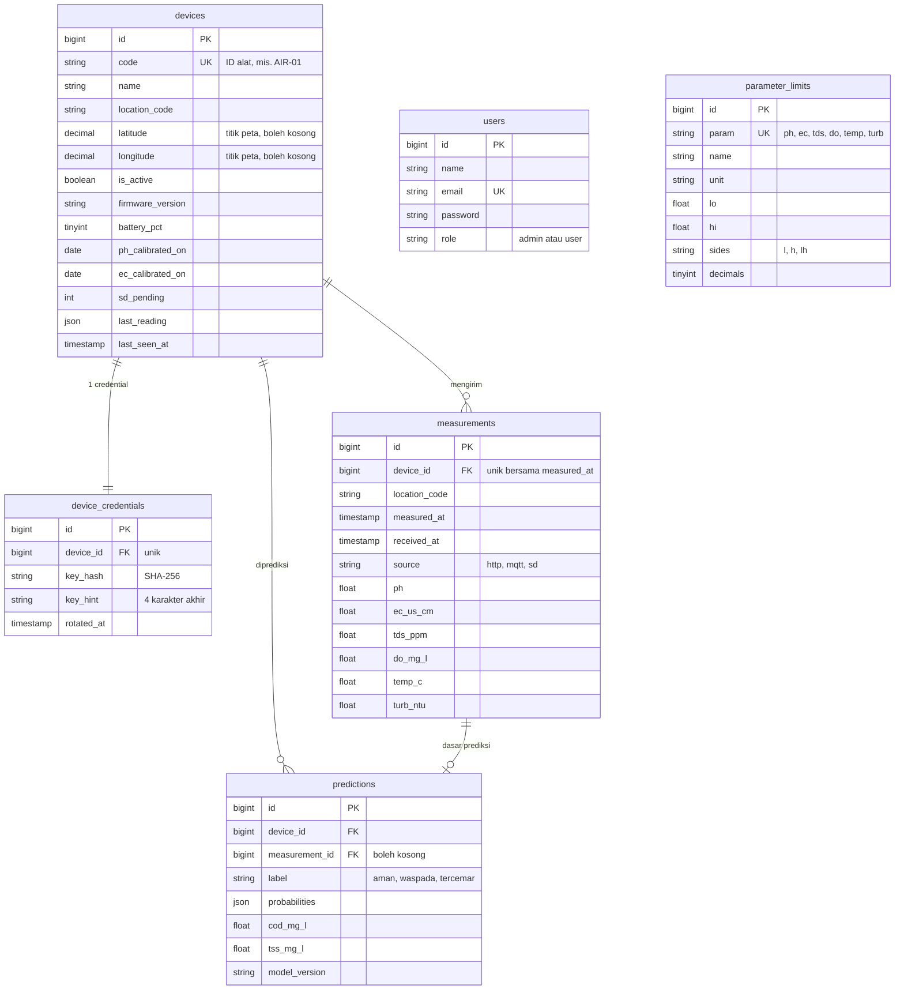

# Skema database AirTracking

Dibuat lewat migrasi Laravel (`database/migrations/2026_10_17_*`), jadi sama di MySQL/MariaDB, PostgreSQL, dan SQLite. Semua waktu disimpan dalam **UTC**.

(`sessions`, `cache`, `jobs`, dan `password_reset_tokens` adalah tabel bawaan Laravel.)

## Tabel

| Tabel | Isi | Catatan desain |
|---|---|---|
| `users` | Akun admin | Kolom `role` ditambahkan. Dashboard publik tidak butuh akun. |
| `devices` | Registrasi alat (CRUD admin) | `code` = "ID alat" di JSON dan topik MQTT. `latitude`/`longitude` = titik alat di peta (kosong bila belum ditandai). `last_reading` menyalin bacaan terakhir agar dashboard cepat. Status alat (baterai, kalibrasi, data SD tertunda) diisi dari payload firmware bila ada. |
| `device_credentials` | Credential per alat | Terpisah dari `devices` supaya tidak ikut query publik. Hanya hash SHA-256 yang disimpan; teks asli tampil sekali saat dibuat atau diganti. |
| `measurements` | Data sensor | **Unik (`device_id`, `measured_at`)**: kirim ulang paket SD tidak menggandakan data. Indeks unik itu juga mempercepat query riwayat per alat. |
| `predictions` | Hasil klasifikasi kualitas air | Satu baris tiap kali alat mengirim data. `cod_mg_l` dan `tss_mg_l` disiapkan untuk model ML (belum ada). |
| `parameter_limits` | Rentang normal (baku mutu) | Bisa diubah admin tanpa mengubah kode. |

## Pemetaan nama (JSON ⇄ kolom)

| Kunci JSON | Kolom `measurements` | Satuan |
|---|---|---|
| `ph` | `ph` | – |
| `ec` | `ec_us_cm` | µS/cm |
| `tds` | `tds_ppm` | ppm |
| `do` | `do_mg_l` | mg/L |
| `temp` | `temp_c` | °C |
| `turb` | `turb_ntu` | NTU |

Kolom tidak dinamai `do` karena itu kata cadangan SQL. Pemetaan ada di satu tempat: `Quality::COLUMNS`.

## Dibanding skema Supabase sebelumnya

| Sebelumnya | Sekarang | Alasan |
|---|---|---|
| `devices.id` (teks, mis. AIR-01) | `devices.id` (angka) + `devices.code` | Relasi lebih ringan; ID alat tetap bisa diganti nama tanpa memutus relasi. |
| `device_keys.credential` (teks asli) | `device_credentials.key_hash` | Credential tidak tersimpan terbaca. |
| `water_logs` | `measurements` | Nama kolom berskala jelas (satuan di nama), tanpa kolom `do`. |
| `profiles.role` | `users.role` | Login ditangani Laravel, bukan Supabase Auth. |
| (tidak ada) | `predictions`, `parameter_limits`, status alat | Dibutuhkan dashboard v1 (prediksi, baku mutu, baterai/kalibrasi/SD). |
| RLS Supabase | Pemisahan lewat route dan middleware `EnsureAdmin` | Akses ke database hanya lewat aplikasi Laravel. |
